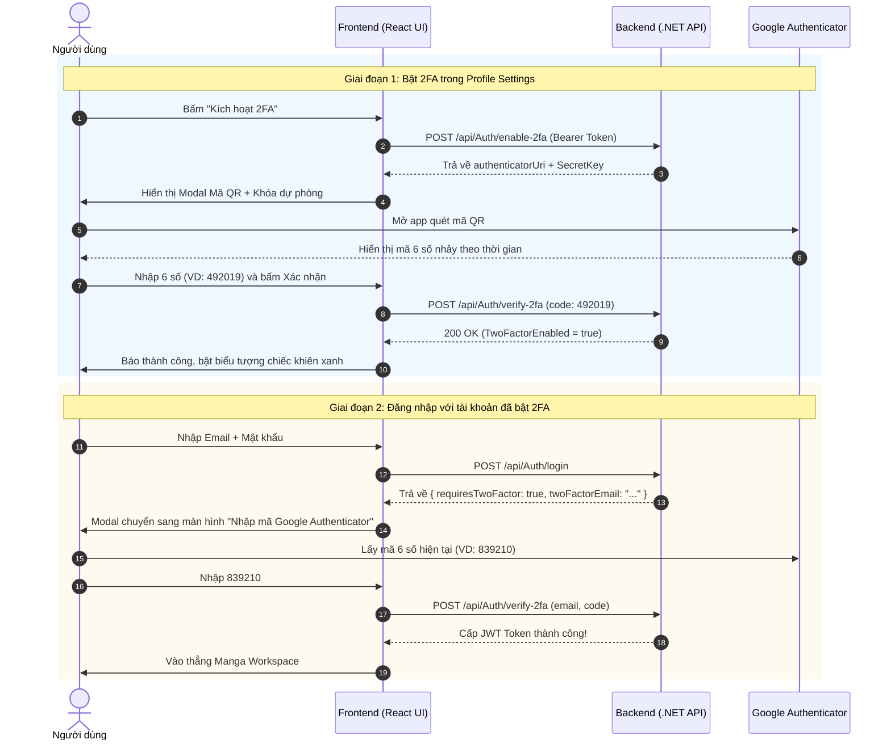

# BÁO CÁO REVIEW: GIẢI PHÁP BẢO MẬT 2FA (TWO-FACTOR AUTHENTICATION) BẰNG GOOGLE AUTHENTICATOR

> **Dự án**: PanelForge Manga Studio  
> **Tính năng**: Xác thực hai yếu tố 2FA (RFC 6238 TOTP - Time-Based One-Time Password)  
> **Mục đích**: Tính năng bảo mật nâng cao ghi điểm tối đa trong hội đồng bảo vệ đồ án tốt nghiệp (SEP490).  
> **Trạng thái**: Chờ duyệt (Pending Approval)

---

## I. GIÁ TRỊ CỦA TÍNH NĂNG 2FA KHI THUYẾT MINH ĐỒ ÁN (SELLING POINTS)

Khi hội đồng phản biện hỏi: *"Hệ thống của bạn bảo vệ tài khoản của các họa sĩ và tác giả bản quyền truyện tranh như thế nào trước nguy cơ bị lộ mật khẩu?"*, 2FA chính là câu trả lời đanh thép nhất:

1. **Chuẩn bảo mật quốc tế RFC 6238 (TOTP)**:
   * Hệ thống không dùng mã SMS (dễ bị tấn công SIM Swap và tốn chi phí thuê tổng đài SMS), mà sử dụng thuật toán băm thời gian thực **HMAC-SHA1** tiêu chuẩn thế giới.
   * Tương thích 100% với mọi ứng dụng Authenticator phổ biến: **Google Authenticator**, **Microsoft Authenticator**, **Authy**, **Apple Keychain**, **1Password**.
2. **Bảo vệ tài sản trí tuệ (Studio Assets Protection)**:
   * Bản thảo manga và truyện tranh là tài sản độc quyền. Ngay cả khi hacker đánh cắp được Email và Password (qua phishing hoặc lộ dữ liệu từ web khác), hacker vẫn **hoàn toàn bất lực** vì không có mã 6 số thay đổi mỗi 30 giây trên điện thoại cá nhân của tác giả.
3. **Thuật toán xử lý lệch thời gian (Clock Drift Handling)**:
   * Backend cấu hình `VerificationWindow(previous: 1, future: 1)`, nghĩa là cho phép độ trễ ±30 giây giữa đồng hồ điện thoại của người dùng và đồng hồ server, giúp người dùng không bao giờ bị từ chối oan do mạng lag hay lệch múi giờ.

---

## II. ĐẶC TẢ CHI TIẾT 2 API BACKEND ĐÃ CÓ SẴN

Mã nguồn Backend C# của bạn trong `AuthController.cs` và `AuthService.cs` **đã được cài đặt hoàn thiện 100% logic** cho 2 endpoint này:

### 1. API Kích hoạt 2FA: `POST /api/Auth/enable-2fa`
* **Quyền hạn**: Bắt buộc đăng nhập (`[Authorize]`, gửi kèm `Authorization: Bearer <JWT_Token>`).
* **Nghiệp vụ**:
  * Server sinh khóa bí mật ngẫu nhiên 20 bytes (160-bit entropy) bằng bộ sinh số an toàn mật mã học (`RandomNumberGenerator`).
  * Mã hóa khóa này sang dạng chuỗi **Base32**.
  * Tạo chuỗi liên kết chuẩn:
    ```text
    otpauth://totp/PanelForge:user@example.com?secret=JBSWY3DPEHPK3PXP&issuer=PanelForge&digits=6&period=30
    ```
* **Dữ liệu trả về (JSON)**:
  ```json
  {
    "sharedKey": "JBSWY3DPEHPK3PXP",
    "authenticatorUri": "otpauth://totp/PanelForge:user@example.com?secret=JBSWY3DPEHPK3PXP&issuer=PanelForge&digits=6&period=30",
    "formattedKey": "JBSW Y3DP EHPK 3PXP"
  }
  ```
  *(Frontend sẽ dùng chuỗi `authenticatorUri` này để vẽ mã QR cho người dùng lấy điện thoại quét).*

---

### 2. API Xác thực mã 2FA: `POST /api/Auth/verify-2fa`
API này được thiết kế thông minh hỗ trợ **2 kịch bản nghiệp vụ**:

#### Kịch bản A: Kích hoạt lần đầu (Đang đăng nhập)
* Người dùng quét mã QR, sau đó nhập mã 6 số trên điện thoại để xác nhận kích hoạt.
* Request: Gửi kèm Header `Authorization: Bearer <Token>` + Body:
  ```json
  {
    "code": "584920"
  }
  ```
* Server kiểm tra mã khớp ➔ Bật cờ `TwoFactorEnabled = true` trong database.

#### Kịch bản B: Đăng nhập có bảo vệ 2FA (Chưa có Token)
* Khi người dùng nhập Email + Password đúng, nhưng tài khoản đã bật 2FA:
  * API `POST /api/Auth/login` sẽ trả về:
    ```json
    {
      "token": null,
      "requiresTwoFactor": true,
      "twoFactorEmail": "artist@studio.com",
      "message": "Yêu cầu xác thực 2FA. Vui lòng nhập mã OTP 6 chữ số từ ứng dụng Authenticator."
    }
    ```
* Người dùng nhập mã 6 số từ Google Authenticator và gửi lên `POST /api/Auth/verify-2fa`:
  ```json
  {
    "email": "artist@studio.com",
    "code": "584920"
  }
  ```
* Server xác thực thành công ➔ Cấp JWT Token đầy đủ để vào hệ thống.

---

## III. USER FLOW TRÊN GIAO DIỆN (UI/UX)



---

## IV. CÁC CÔNG VIỆC CẦN LÀM TRÊN FRONTEND (KHI BẠN DUYỆT)

1. **Cài thư viện tạo QR Code nội bộ**:
   * Cài đặt `qrcode.react`: Thư viện React cực nhẹ (~10KB) giúp vẽ mã QR trực tiếp trên Canvas/SVG của trình duyệt mà không phải gửi dữ liệu ra ngoài Internet (bảo mật tuyệt đối).
2. **Bổ sung API vào `auth.service.ts`**:
   * `authService.enableTwoFactor(token)`
   * `authService.verifyTwoFactor(code, email?, token?)`
3. **Cập nhật `LoginModal.tsx`**:
   * Bổ sung trạng thái Challenge: Khi `login` trả về `requiresTwoFactor === true`, modal tự động chuyển sang giao diện nhập 6 số Google Authenticator.
4. **Tạo Component `TwoFactorSettingsModal.tsx`**:
   * Đặt trong trang Profile/Settings: Cho phép người dùng bật/tắt 2FA, hiển thị mã QR và khóa sao lưu khẩn cấp.

---

## V. KẾT LUẬN & ĐỀ XUẤT PHÊ DUYỆT

* Backend của bạn **đã có sẵn 100% logic thuật toán 2FA**, không cần sửa thêm bất kỳ dòng C# nào ở Backend.
* Frontend chỉ cần thêm màn hình quét mã QR và màn hình nhập mã 6 số khi đăng nhập.
* Đây là tính năng chuẩn công nghiệp, rất "sáng nước" và thuyết phục tuyệt đối khi đem đi chấm điểm đồ án.

👉 **Xin ý kiến từ bạn**: Bạn có đồng ý triển khai giao diện và tích hợp tính năng 2FA này lên Frontend không? Nếu bạn đồng ý, hãy phản hồi để tôi tiến hành triển khai ngay nhé!
