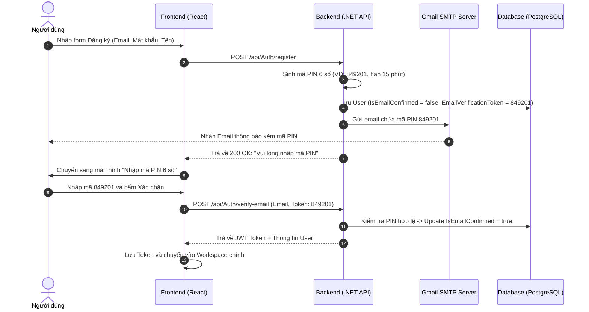

# BÁO CÁO REVIEW: GIẢI PHÁP GỬI MÃ PIN KHI ĐĂNG KÝ TÀI KHOẢN (BACKEND .NET)

> **Mục tiêu**: Khi người dùng đăng ký tài khoản mới (`POST /api/Auth/register`), hệ thống sẽ tự động tạo một mã PIN (OTP 6 số), gửi qua Email người dùng và yêu cầu xác thực mã PIN này trước khi cho phép đăng nhập vào hệ thống.
> **Trạng thái**: Chờ duyệt (Pending Approval)

---

## I. ĐÁNH GIÁ HIỆN TRẠNG TRONG CODEBASE BACKEND

Sau khi rà soát mã nguồn Backend hiện tại (`AuthService.cs`, `EmailService.cs`, `AuthController.cs`, `User.cs`), kết quả cho thấy:

### 1. Những phần Backend ĐÃ CÓ SẴN (Đạt 70% khối lượng)
1. **Entity `User.cs`**:
   * Đã có các trường: `EmailVerificationToken` (lưu mã PIN), `EmailVerificationTokenExpiresAt` (thời hạn mã PIN), `IsEmailConfirmed` (trạng thái đã kích hoạt hay chưa).
   * Đã có sẵn hàm `SetEmailVerificationToken(token, expiresAt)` và `ConfirmEmail()`.
2. **Hạ tầng gửi Mail `EmailService.cs`**:
   * Đã có sẵn template HTML hiển thị mã PIN 6 số to rõ ràng tại hàm `SendEmailVerificationAsync`.
   * Sử dụng giao thức chuẩn SMTP của .NET (`SmtpClient`, `MailMessage`).
3. **Logic sinh mã PIN trong `AuthService.cs`**:
   * Hàm `RegisterAsync` đã có đoạn sinh mã 6 số:
     ```csharp
     var verificationOtp = RandomNumberGenerator.GetInt32(100000, 999999).ToString();
     user.SetEmailVerificationToken(verificationOtp, DateTime.UtcNow.AddMinutes(15));
     ```
4. **Endpoints trong `AuthController.cs`**:
   * Đã có sẵn 3 endpoint:
     * `POST /api/Auth/register`: Đăng ký và kích hoạt gửi mã PIN.
     * `POST /api/Auth/verify-email`: Tiếp nhận mã PIN người dùng nhập để kích hoạt tài khoản.
     * `POST /api/Auth/resend-verification`: Gửi lại mã PIN mới nếu mã cũ hết hạn.

---

### 2. Những LỖ HỔNG & THIẾU SÓT cần khắc phục (Lý do hiện tại chưa gửi được mail)

* **Vấn đề 1 (Nghiêm trọng - Gây lỗi gửi mail)**:
  * Trong `appsettings.json` và `appsettings.Development.json` **hoàn toàn chưa có cấu hình `EmailConfiguration`**.
  * Khi đăng ký, hàm `SendEmailAsync` gọi:
    ```csharp
    var senderEmail = _config["EmailConfiguration:SenderEmail"] ?? throw new ArgumentNullException(...);
    var password = _config["EmailConfiguration:Password"] ?? throw new ArgumentNullException(...);
    ```
    ➔ Do thiếu cấu hình, hệ thống gặp ngoại lệ `ArgumentNullException` và **không có email nào được gửi đi**.
* **Vấn đề 2 (Lỗ hổng nghiệp vụ - Chưa bắt buộc xác thực PIN)**:
  * Trong hàm `LoginAsync`, hệ thống **chưa kiểm tra** cờ `user.IsEmailConfirmed`.
  * Người dùng sau khi đăng ký xong, dù chưa nhập mã PIN vẫn có thể đăng nhập bình thường!
* **Vấn đề 3 (Rủi ro UX & Bảo mật)**:
  * Trong `RegisterAsync`, hệ thống đang tạo và trả về JWT Token ngay lập tức. Cần sửa lại: Đăng ký thành công chỉ trả về thông báo yêu cầu nhập mã PIN, **chỉ cấp JWT Token sau khi đã xác thực mã PIN thành công** ở endpoint `verify-email`.
* **Vấn đề 4 (Thời gian sống của mã PIN)**:
  * Hiện tại đang để hạn 24 giờ (`AddHours(24)`). Đối với mã PIN/OTP xác thực, chuẩn an toàn là **10 - 15 phút** (`AddMinutes(15)`).

---

## II. ĐỀ XUẤT GIẢI PHÁP TRIỂN KHAI CHI TIẾT

### Bước 1: Cấu hình SMTP Email Server trong `appsettings.Development.json`

Thêm khối cấu hình gửi mail vào file `PanelForge.API/appsettings.Development.json`:

```json
{
  "EmailConfiguration": {
    "SenderName": "PanelForge Manga Studio",
    "SenderEmail": "your-email@gmail.com",
    "Password": "xxxx xxxx xxxx xxxx", 
    "SmtpServer": "smtp.gmail.com",
    "SmtpPort": 587
  }
}
```
*(Trong đó `Password` là **Mật khẩu ứng dụng (App Password 16 ký tự)** tạo từ tài khoản Google của bạn, không phải mật khẩu đăng nhập cá nhân).*

---

### Bước 2: Cập nhật `RegisterAsync` (Không trả về Token khi chưa xác thực PIN)

Trong `PanelForge.Infrastructure/Services/AuthService.cs`:
```csharp
// Sinh mã PIN 6 chữ số ngẫu nhiên
var verificationOtp = RandomNumberGenerator.GetInt32(100000, 999999).ToString();

// Thiết lập mã PIN hết hạn trong vòng 15 phút (chuẩn bảo mật)
user.SetEmailVerificationToken(verificationOtp, DateTime.UtcNow.AddMinutes(15));

_dbContext.Users.Add(user);
await _dbContext.SaveChangesAsync(cancellationToken);

// Gửi Email chứa mã PIN
await _emailService.SendEmailVerificationAsync(user.Email, verificationOtp, user.FullName, cancellationToken);

// KHÔNG CẤP JWT TOKEN NGAY, yêu cầu người dùng kích hoạt trước
return new AuthResponse(
    Token: null,
    ExpiresAt: null,
    User: MapUserDto(user),
    Message: "Đăng ký thành công! Mã PIN xác thực 6 số đã được gửi đến email của bạn."
);
```

---

### Bước 3: Cập nhật `LoginAsync` (Chặn đăng nhập nếu chưa nhập mã PIN)

Thêm điều kiện kiểm tra `IsEmailConfirmed` vào hàm `LoginAsync`:
```csharp
if (!user.IsEmailConfirmed)
{
    throw new UnauthorizedAccessException("Tài khoản chưa được kích hoạt. Vui lòng kiểm tra email và nhập mã PIN để xác thực.");
}
```

---

### Bước 4: Cập nhật `VerifyEmailAsync` (Cấp Token ngay sau khi nhập mã PIN đúng)

Khi người dùng nhập đúng mã PIN ở màn hình xác thực, Backend sẽ kích hoạt tài khoản và cấp luôn JWT Token để người dùng vào thẳng ứng dụng mà không cần gõ lại mật khẩu:
```csharp
public async Task<AuthResponse> VerifyEmailAsync(VerifyEmailRequest request, CancellationToken cancellationToken = default)
{
    var normalizedEmail = request.Email.Trim().ToLowerInvariant();
    var user = await _dbContext.Users.FirstOrDefaultAsync(u => u.Email == normalizedEmail, cancellationToken);

    if (user is null || !user.IsActive)
    {
        throw new ArgumentException("Tài khoản không tồn tại hoặc đã bị vô hiệu hóa.");
    }

    if (user.IsEmailConfirmed)
    {
        var (token, expiresAt) = _jwtTokenGenerator.GenerateToken(user);
        return new AuthResponse(token, expiresAt, MapUserDto(user), "Tài khoản đã được xác thực từ trước.");
    }

    // Kiểm tra tính chính xác của mã PIN
    if (string.IsNullOrEmpty(user.EmailVerificationToken) || !string.Equals(user.EmailVerificationToken, request.Token.Trim(), StringComparison.Ordinal))
    {
        throw new ArgumentException("Mã PIN xác thực không chính xác.");
    }

    // Kiểm tra thời hạn mã PIN
    if (!user.EmailVerificationTokenExpiresAt.HasValue || user.EmailVerificationTokenExpiresAt.Value < DateTime.UtcNow)
    {
        throw new ArgumentException("Mã PIN xác thực đã hết hạn. Vui lòng yêu cầu gửi mã mới.");
    }

    // Kích hoạt tài khoản và xóa token cũ
    user.ConfirmEmail();
    await _dbContext.SaveChangesAsync(cancellationToken);

    // Cấp Token đăng nhập tự động
    var (jwtToken, tokenExpiresAt) = _jwtTokenGenerator.GenerateToken(user);
    return new AuthResponse(jwtToken, tokenExpiresAt, MapUserDto(user), "Xác thực tài khoản thành công!");
}
```

---

## III. LUỒNG TRẢI NGHIỆM NGƯỜI DÙNG (USER FLOW HOÀN CHỈNH)



---

## IV. BẢNG TỔNG HỢP CÁC FILE CẦN CHỈNH SỬA

| STT | File Cần Sửa | Thao Tác | Nội Dung Thay Đổi |
| :---: | :--- | :---: | :--- |
| 1 | `PanelForge.API/appsettings.Development.json` | Cấu hình | Thêm khối `EmailConfiguration` (SenderEmail, App Password) |
| 2 | `PanelForge.Infrastructure/Services/AuthService.cs` | Logic C# | Cập nhật `RegisterAsync` (hạn 15 phút, không cấp token sớm) |
| 3 | `PanelForge.Infrastructure/Services/AuthService.cs` | Logic C# | Cập nhật `LoginAsync` (chặn đăng nhập nếu `!IsEmailConfirmed`) |
| 4 | `PanelForge.Infrastructure/Services/AuthService.cs` | Logic C# | Cập nhật `VerifyEmailAsync` (cấp Token đăng nhập ngay khi xác thực đúng) |
| 5 | `PanelForge.Application/Common/Interfaces/Services/IAuthService.cs` | Interface | Đổi kiểu trả về của `VerifyEmailAsync` sang `Task<AuthResponse>` |
| 6 | `PanelForge.API/Controllers/AuthController.cs` | Controller | Trả về `Ok(response)` chứa Token ở endpoint `verify-email` |

---

## V. KẾT LUẬN & ĐỀ XUẤT PHÊ DUYỆT

* Giải pháp này tận dụng **70% nền tảng đã viết sẵn** trong Backend của bạn, không làm xáo trộn kiến trúc Clean Architecture.
* Đảm bảo tính bảo mật cao (chống spam đăng ký ảo, mã PIN có hạn sử dụng, chỉ đăng nhập được khi email có thật).
* Luồng trải nghiệm mượt mà: Sau khi nhập PIN đúng là tự động đăng nhập luôn mà không phải nhập lại mật khẩu lần 2.

👉 **Xin ý kiến duyệt từ bạn**: Bạn có đồng ý với phương án thiết kế này không? Nếu bạn duyệt, tôi sẽ tiến hành cập nhật mã nguồn theo đúng các bước trên!
