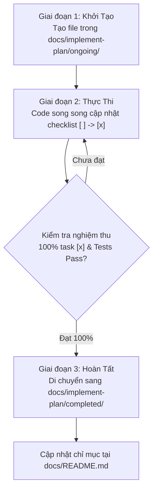

# 📚 QUY TRÌNH QUẢN LÝ TÀI LIỆU & ĐỒNG BỘ SOURCE CODE (DOCUMENTATION PROCESS)

> **Dự án:** PanelForge Manga Studio Frontend (`panelforge-fe`)  
> **Phiên bản:** 1.0  
> **Áp dụng cho:** Toàn bộ thành viên phát triển (Developers, Technical Leads) và AI Coding Agents.

---

## 1. MỤC ĐÍCH & NGUYÊN TẮC CỐT LÕI

Hệ thống tài liệu là **tấm gương phản chiếu mã nguồn**. Nhằm loại bỏ tình trạng tài liệu bị phân tán, lỗi thời hoặc không bám sát thực tế code, quy trình này thiết lập:
1. **Single Source of Truth (Nguồn chân lý duy nhất):** Mỗi mảng kiến thức chỉ có một vị trí lưu trữ chuẩn xác.
2. **Zero-Drift Policy (Không lệch pha):** Bất kỳ sự thay đổi nào về giao diện, luồng nghiệp vụ hoặc cấu trúc mã nguồn đều phải được cập nhật đồng thời vào tài liệu tương ứng.
3. **Structured Lifecycle (Vòng đời có cấu trúc):** Mọi kế hoạch triển khai (Implement Plan) đều phải trải qua hai giai đoạn rõ ràng: `ongoing` (đang thực hiện) và `completed` (đã hoàn thành).

---

## 2. CẤU TRÚC THƯ MỤC TÀI LIỆU CHUẨN

```text
panelforge-fe/
├── README.md                           # Giới thiệu tổng quan dự án, kiến trúc, scripts khởi chạy
├── PRODUCT.md                          # Đặc tả nghiệp vụ cốt lõi, mô tả vai trò, 5 core flows của PanelForge
├── CLAUDE.md                           # Hướng dẫn phát triển, quy chuẩn mã nguồn & chỉ dẫn cho AI Agent
│
├── docs/                               # THƯ MỤC TÀI LIỆU KỸ THUẬT CHÍNH
│   ├── README.md                       # Mục lục & trung tâm điều hướng toàn bộ hệ thống docs
│   ├── DOCUMENTATION_PROCESS.md        # [Tài liệu này] Quy chuẩn quản lý & quy trình đồng bộ code-docs
│   ├── DESIGN_RULES.md                 # Quy chuẩn thiết kế giao diện (Quiet Editorial Studio, tokens, font...)
│   │
│   ├── implement-plan/                 # QUẢN LÝ KẾ HOẠCH TRIỂN KHAI
│   │   ├── ongoing/                    # Kế hoạch & danh sách nhiệm vụ ĐANG THỰC HIỆN
│   │   │   └── .gitkeep
│   │   └── completed/                  # Kế hoạch ĐÃ HOÀN THÀNH 100% (nghiệm thu & pass kiểm thử)
│   │       ├── EDITORIAL_STUDIO_DESIGN_PLAN.md
│   │       ├── EDITORIAL_STUDIO_TASK_LIST.md
│   │       └── UI_REFACTOR_CHECKLIST.md
│   │
│   ├── audit/                          # Báo cáo kiểm định chất lượng, rà soát màn hình định kỳ
│   │   └── UI_SCREEN_AUDIT.md
│   │
│   └── archive/                        # TÀI LIỆU LƯU TRỮ LỊCH SỬ (Không xóa, giữ tham khảo kiến trúc)
│       └── reviews/
│           ├── 2FA_AUTHENTICATION_REVIEW.md
│           ├── BACKEND_EMAIL_PIN_VERIFICATION_REVIEW.md
│           └── FE_TESTING_REVIEW.md
│
├── src/                                # TÀI LIỆU KIẾN TRÚC NỘI BỘ MODULE
│   ├── README.md                       # Kiến trúc phân tầng và điều hướng phân quyền (RBAC)
│   ├── shared/README.md                # Đặc tả các component, layouts và hooks dùng chung
│   └── roles/{role}/README.md          # 9 file README đặc tả từng workspace vai trò
│       ├── admin/README.md
│       ├── artist/README.md
│       ├── editor/README.md
│       ├── guest/README.md
│       ├── letterer/README.md
│       ├── producer/README.md
│       ├── publisher/README.md
│       ├── reader/README.md
│       └── writer/README.md
│
└── .github/
    └── PULL_REQUEST_TEMPLATE.md        # Template PR tích hợp checklist đồng bộ docs bắt buộc
```

---

## 3. VÒNG ĐỜI KẾ HOẠCH TRIỂN KHAI (IMPLEMENT PLAN LIFECYCLE)

Mọi tính năng mới, tái cấu trúc (refactoring) hoặc chiến dịch kỹ thuật lớn bắt buộc phải tạo kế hoạch triển khai theo quy trình 3 giai đoạn:



### Bước 1: Khởi tạo trong `ongoing/`
- **Vị trí:** `docs/implement-plan/ongoing/`
- **Quy tắc đặt tên:** `<TÊN_TÍNH_NĂNG>_PLAN.md` hoặc `<TÊN_TÍNH_NĂNG>_TASK_LIST.md` (dùng chữ HOA hoặc `kebab-case`).
- **Cấu trúc Header bắt buộc:**
```markdown
# 📋 [Tên Kế Hoạch Triển Khai]

> **Trạng thái:** 🟡 ONGOING  
> **Người thực hiện:** [Tên dev hoặc AI Agent]  
> **Ngày bắt đầu:** YYYY-MM-DD  
> **Phạm vi tác động:** [Danh sách component / module liên quan]  
> **Mục tiêu:** [Tóm tắt 1-2 câu về kết quả kỳ vọng]

---

## Danh Sách Nhiệm Vụ (Task List)
- [ ] Task 1...
- [ ] Task 2...
```

### Bước 2: Thực thi & Cập nhật liên tục
- Khi bắt đầu thực hiện task nào, dev/agent duy trì tính minh bạch bằng cách chuyển `[ ]` sang `[x]` ngay khi hoàn thành task đó.
- Nếu có quyết định kỹ thuật phát sinh ngoài dự kiến, ghi chú bổ sung trực tiếp vào file.

### Bước 3: Nghiệm thu & Di chuyển sang `completed/`
- **Điều kiện tiên quyết:**
  1. Toàn bộ checkbox trong file đã được tích `[x]`.
  2. Mã nguồn pass kiểm tra kiểu dữ liệu: `npm run typecheck`.
  3. Mã nguồn pass quy chuẩn linter: `npm run lint`.
  4. Bộ kiểm thử tự động pass 100%: `npm run test:run`.
- **Thực hiện di chuyển:**
  ```bash
  git mv docs/implement-plan/ongoing/<FILE_NAME>.md docs/implement-plan/completed/<FILE_NAME>.md
  ```
- **Cập nhật Header:** Đổi `Trạng thái: 🟢 COMPLETED` và thêm `Ngày hoàn thành: YYYY-MM-DD`.
- **Cập nhật chỉ mục:** Thêm liên kết vào bảng mục lục trong `docs/README.md`.

---

## 4. QUY TRÌNH ĐỒNG BỘ SOURCE CODE VỚI TÀI LIỆU (SOURCE-CODE-DOC-SYNC)

Để bảo đảm **code đi đến đâu, docs bám sát đến đó**, mỗi khi thay đổi source code, lập trình viên và AI Agent **bắt buộc** phải tuân thủ ma trận sau:

### 4.1. Ma trận Ánh Xạ Thay Đổi Code → Tài Liệu (Sync Matrix)

| Khu vực Source Code thay đổi | Tài liệu BẮT BUỘC cập nhật | Nội dung cần ghi nhận |
| :--- | :--- | :--- |
| **Giao diện & Theme:**<br>`src/styles/`, Tailwind tokens, màu sắc, font, button styles, layout shell | `docs/DESIGN_RULES.md` | Bổ sung/điều chỉnh mã hex màu sắc, quy tắc font, khoảng cách padding/gap hoặc quy cách component mới. |
| **Nghiệp vụ cốt lõi & Luồng thao tác:**<br>Thêm bước mới trong pipeline, sửa quyền hạn role, logic Series Bible | `PRODUCT.md` &<br>`src/roles/{role}/README.md` | Cập nhật luồng nghiệp vụ tương ứng trong `PRODUCT.md` và bảng danh sách views/capabilities của role. |
| **Workspace Vai Trò:**<br>Thêm/xóa/sửa views, modals trong `src/roles/{role}/` | `src/roles/{role}/README.md` | Cập nhật cấu trúc thư mục, danh mục màn hình (`views`), modals và dependencies của role đó. |
| **Thành phần dùng chung:**<br>Thêm/sửa components trong `src/shared/`, `src/components/` | `src/shared/README.md` | Bổ sung prop types, mục đích sử dụng và ví dụ tích hợp component dùng chung. |
| **API Client & Data Contract:**<br>Thêm endpoint mới trong `src/services/api/`, models | `src/roles/{role}/README.md` &<br>Implement Plan liên quan | Ghi rõ API endpoints được tích hợp vào bảng kết nối API của role tương ứng. |
| **Cấu hình & Môi trường:**<br>`package.json`, scripts, environment variables | `README.md` (root) &<br>`CLAUDE.md` | Cập nhật lệnh chạy, dependencies chính hoặc biến môi trường mới. |

### 4.2. Cơ chế Kiểm Soát (Enforcement Gates)

#### Gate 1: Pull Request Template Checklist
Mỗi PR gửi lên repository bắt buộc phải vượt qua checklist tài liệu trong `.github/PULL_REQUEST_TEMPLATE.md`:
```markdown
### 📚 Documentation Sync Verification
- [ ] Đã kiểm tra và cập nhật tài liệu tương ứng theo `docs/DOCUMENTATION_PROCESS.md`:
  - [ ] `docs/DESIGN_RULES.md` (nếu thay đổi UI/tokens)
  - [ ] `PRODUCT.md` (nếu thay đổi luồng nghiệp vụ cốt lõi)
  - [ ] `src/roles/{role}/README.md` (nếu thay đổi views/modals của role)
  - [ ] `src/shared/README.md` (nếu thêm/sửa shared components)
- [ ] Nếu là tính năng mới: Đã hoàn thành Task List và di chuyển sang `docs/implement-plan/completed/`.
- [ ] Đã kiểm tra không có liên kết markdown nào bị gãy (broken links).
```

#### Gate 2: Ràng buộc AI Assistant (Agent Rule)
Khi làm việc với các AI Coding Assistant (như Claude/Antigravity), quy tắc sau được ghi trong `CLAUDE.md`:
> *"Trước khi kết thúc bất kỳ nhiệm vụ nào liên quan đến thay đổi cấu trúc mã nguồn, UI tokens hoặc luồng nghiệp vụ, AI phải tự động rà soát và cập nhật các file markdown tương ứng theo quy định tại `docs/DOCUMENTATION_PROCESS.md`."*

---

## 5. QUY TẮC DỌN DẸP & LƯU TRỮ (CLEANUP & ARCHIVE POLICY)

1. **Những file ĐƯỢC PHÉP XÓA:**
   - File nháp PR tạm thời (ví dụ: `PR_DESCRIPTION.md` sau khi PR đã được merge).
   - Scratchpad, file ghi chú tạm của cá nhân sau khi hoàn thành phiên làm việc.
   - Tài liệu duplicate hoàn toàn về nội dung với tài liệu chính thống.

2. **Những file PHẢI LƯU TRỮ (`docs/archive/`):**
   - Các bản review bảo mật, audit kỹ thuật, sprint testing review lịch sử có giá trị chứng minh quá trình phát triển (ví dụ: review 2FA, email PIN).
   - Đặt trong `docs/archive/reviews/` hoặc `docs/archive/<topic>/`.

3. **Những file TUYỆT ĐỐI KHÔNG XÓA:**
   - `PRODUCT.md` và `CLAUDE.md` tại root.
   - `docs/DESIGN_RULES.md`, `docs/README.md`, `docs/DOCUMENTATION_PROCESS.md`.
   - Các file `src/roles/*/README.md` và `src/shared/README.md`.
   - Các file đã chuyển vào `docs/implement-plan/completed/`.

---

## 6. QUY ƯỚC ĐỊNH DẠNG MARKDOWN

- **Tiêu đề (Headings):** Mỗi file chỉ có duy nhất một thẻ `# H1`. Các phân mục dùng `## H2`, `### H3`.
- **Liên kết file (File Links):** Luôn dùng đường dẫn tương đối (relative path) để click được cả trên GitHub Web và IDE:
  - Đúng: `[Quy tắc thiết kế](./DESIGN_RULES.md)`
  - Sai: `[Quy tắc thiết kế](/docs/DESIGN_RULES.md)` hoặc đường dẫn tuyệt đối local `d:/...`
- **Khối mã (Code Blocks):** Luôn khai báo ngôn ngữ (vd: ````bash````, ````tsx````, ````json````, ````text````).
- **Trực quan hóa luồng:** Khuyến khích sử dụng sơ đồ Mermaid (`mermaid`) cho các luồng nghiệp vụ phức tạp.
