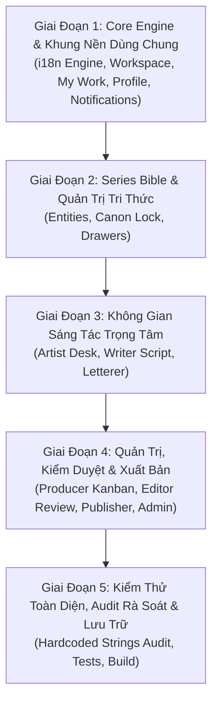

# Kế Hoạch Triển Khai: Bản Địa Hóa Tiếng Anh Toàn Diện Cho Toàn Hệ Thống (System-Wide English Localization & i18n Architecture)

> **Mã kế hoạch:** `PF-PLAN-I18N-SYSTEMWIDE`  
> **Trạng thái:** 🟢 **Hoàn thành (Completed)**  
> **Mục tiêu:** Mở rộng và áp dụng hệ thống đa ngôn ngữ (i18n) vào 100% các màn hình giao diện (Views), bảng điều khiển vai trò (Role Desks), các thành phần dùng chung (Shared Components) và hộp thoại (Modals) hiển thị bên trong AppShell; đảm bảo khi người dùng chuyển sang Tiếng Anh (`EN`), toàn bộ ứng dụng lập tức chuyển ngữ mượt mà, chuẩn xác và giữ nguyên vẹn trải nghiệm thẩm mỹ Editorial Manga Studio.

---

## 1. Phân Tích Hiện Trạng & Vấn Đề (Problem Statement)

### 1.1. Hiện trạng ban đầu
- **Thanh vỏ ngoài (AppShell Navigation & Header):** Đã kết nối với `useTranslation()`, chuyển đổi song ngữ cho Menu Sidebar, Header Search placeholder, Profile dropdown menu và cờ trạng thái offline.
- **Nội dung hiển thị bên trong (`AppShell <main>{children || <Outlet />}</main>`):**
  - Trước đây: Phần lớn các màn hình giao diện nghiệp vụ bên trong vẫn chứa chuỗi văn bản Tiếng Việt viết cứng (hardcoded strings) trực tiếp trong JSX/TSX.
  - Các hook `useTranslation()` chưa được import và gọi trong các view chính (`ArtistDeskView`, `ScriptEditorView`, `LettererDeskView`, `ReviewView`, `DashboardView`, `SeriesBibleView`, `MyWorkView`, `WorkspaceListView`, v.v.).
  - Các tệp từ điển trong `src/locales/{vi,en}/` mới chỉ chứa các khóa sơ khai hoặc danh mục cơ bản.

### 1.2. Kết quả đạt được
1. **Bao phủ 100% UI:** Toàn bộ text hiển thị tới người dùng đã đi qua hàm `t('namespace.key')`.
2. **Kiến trúc Namespaces chuẩn hóa:** Mở rộng từ điển có cấu trúc phân tầng rõ ràng theo 12 miền nghiệp vụ (Domain-driven i18n).
3. **Chuyển ngữ tức thì (Zero-Reload Transition):** Khi bấm nút `VI` hoặc `EN` trên `LanguageSwitcher`, toàn bộ màn hình đang mở lập tức re-render với ngôn ngữ mới mà không cần F5/tải lại trang.
4. **Bảo toàn Hợp đồng Kiểm thử (Preserve Test Contracts):** Ngôn ngữ mặc định là Tiếng Việt (`vi`). Hệ thống i18n cung cấp fallback thông minh để 100% test suites (hơn 100 tests) đều pass mượt mà.

---

## 2. Kiến Trúc & Cấu Trúc Từ Điển Mở Rộng (`src/locales/`)

Hệ thống đã chuẩn hóa và mở rộng thành **12 Namespaces** chuyên biệt:

| Namespace | Tệp (`vi/` & `en/`) | Phạm vi bao phủ |
| :--- | :--- | :--- |
| **`common`** | `common.json` | Nút bấm chung (Lưu, Hủy, Đóng, Xóa), trạng thái hệ thống, phân trang, thông báo toast, ngày giờ, chế độ ngoại tuyến. |
| **`navigation`** | `navigation.json` | Menu sidebar theo vai trò, breadcrumbs, tiêu đề header, menu người dùng. |
| **`workspace`** | `workspace.json` | Danh sách Studio Workspace, danh sách Series, tạo Studio mới, quản lý thành viên, lời mời, phân quyền vai trò. |
| **`collaboration`** | `collaboration.json` | "Nhiệm vụ của tôi" (My Work), AssignmentWorkCard, bộ lọc tiến độ, nộp bài, thời hạn, lịch sử hoạt động. |
| **`bible`** | `bible.json` | Hồ sơ tác phẩm (Series Bible), nhân vật (Character), bối cảnh (Environment), đạo cụ (Prop), bản khoá chuẩn (Canon Lock), thay thế bản khoá (Supersede), quan hệ thực thể. |
| **`production`** | `production.json` | Bàn vẽ Artist Desk (bố cục ô khung, 2 chế độ tải ảnh, toạ độ, toolbar, mẫu khung tranh), Kịch bản Writer (phân cảnh, lời thoại, chỉ dẫn), Letterer (bóng thoại, typo, tràn chữ, thứ tự đọc). |
| **`review`** | `review.json` | Ban biên tập (Editor Review): So sánh diff, phê duyệt, trả về bản nộp, Change Requests, AI Consistency Findings, Báo cáo nguồn gốc (Provenance Report). |
| **`pipeline`** | `pipeline.json` | Điều phối sản xuất (Producer): Kanban board, cấu hình công đoạn pipeline, tạo phân công việc (`CreateAssignmentModal`), biểu đồ tiến độ. |
| **`publisher`** | `publisher.json` | Cổng phát hành (Publishing Gate), kiểm tra checklist phát hành, lịch xuất bản (Release Calendar), danh mục kênh xuất bản. |
| **`admin`** | `admin.json` | Quản trị viên hệ thống (Admin Dashboard): Quản lý người dùng toàn hệ thống, cấu hình hạn mức (Quota), nhật ký hệ thống (Audit Logs). |
| **`notifications`** | `notifications.json` | Trung tâm thông báo: Danh sách thông báo, phân loại (Giao việc, Duyệt bài, Đề xuất sửa đổi), thao tác đánh dấu đã đọc. |
| **`profile`** | `profile.json` | Thông tin tài khoản người dùng, cập nhật mật khẩu, xác thực hai yếu tố (2FA TOTP). |

---

## 3. Lộ Trình Triển Khai Chi Tiết (5 Giai Đoạn Đã Hoàn Thành)

---

### 📌 Giai Đoạn 1: Mở Rộng Core Engine & Bản Địa Hóa Khung Nền Dùng Chung (Shared Core) - [x] Hoàn thành
- [x] **1.1. Cập nhật `src/lib/i18n.tsx`:**
  - Đăng ký và nạp toàn bộ 12 namespaces từ điển cho cả `vi` và `en`.
  - Cập nhật định nghĩa TypeScript `TranslationNamespace` tự động gợi ý code type-safe khi viết `t('namespace.key')`.
  - Hỗ trợ `useTranslation(defaultNamespace)` với khả năng tự động prepend namespace thông minh.
- [x] **1.2. Mở rộng từ điển nền tảng:**
  - Bổ sung đầy đủ cho `common.json`, `workspace.json`, `collaboration.json`, `profile.json`, `notifications.json`.
- [x] **1.3. Bản địa hóa các màn hình điều hướng & dùng chung:**
  - `src/shared/views/WorkspaceListView.tsx`: Danh sách Studio, thẻ Workspace, trạng thái vai trò.
  - `src/shared/features/collaboration/MyWorkView.tsx`: Bộ lọc nhiệm vụ, danh sách tab (*Đang làm, Chờ nộp, Đã hoàn thành*), nút thao tác nhanh.
  - `src/shared/features/collaboration/AssignmentWorkCard.tsx`: Thẻ nhiệm vụ, trạng thái công đoạn, deadline, phiên bản `(v...)`.
  - `src/shared/views/UserProfileView.tsx` & các modal liên quan.
  - `src/shared/views/NotificationCenterView.tsx` & `NotificationBell.tsx`.

---

### 📌 Giai Đoạn 2: Bản Địa Hóa Series Bible & Quản Trị Tri Thức (Series Bible Core) - [x] Hoàn thành
- [x] **2.1. Hoàn thiện từ điển `bible.json` (Việt & Anh):**
  - Các danh mục thực thể: Nhân vật (Character), Bối cảnh (Environment), Đạo cụ (Prop), Cốt truyện (Lore).
  - Thuộc tính chi tiết: Bảng khoá chuẩn (Canon Lock), Drawer theo Panel/Chapter.
- [x] **2.2. Bản địa hóa giao diện Series Bible:**
  - `src/shared/features/series-bible/SeriesBibleView.tsx`: Tiêu đề, danh mục thực thể, tabs.
  - `src/shared/features/collaboration/BibleReferenceDrawer.tsx`: Ngăn kéo tham chiếu Series Bible hiển thị trên các bàn sáng tác (byPanel, byChapter, versionLock).

---

### 📌 Giai Đoạn 3: Bản Địa Hóa Không Gian Sáng Tác Trọng Tâm (Artist, Writer, Letterer) - [x] Hoàn thành
- [x] **3.1. Bàn Vẽ Họa Sĩ (Artist Desk - `src/roles/artist/`):**
  - `ArtistDeskView.tsx`: Tiêu đề trang, trạng thái trang, readout thông số, thông báo nhiệm vụ.
  - `VisualPanelUploader.tsx`: Dropzone kéo thả ảnh, 2 chế độ tải (*Tải từng khung - Panel Slice* và *Tải cả trang - Full-Page Composite*).
  - `FrameTemplateModal.tsx`: Danh mục mẫu khung tranh.
- [x] **3.2. Không Gian Kịch Bản (Writer Workspace - `src/roles/writer/`):**
  - `ScriptEditorView.tsx`: Biên soạn kịch bản phân cảnh, danh sách nhân vật thoại, chỉ dẫn diễn xuất (Stage directions), dropdown chọn chương.
- [x] **3.3. Không Gian Thoại & Chữ (Letterer Workspace - `src/roles/letterer/`):**
  - `LettererDeskView.tsx` & `LetteringWorkspace.tsx`: Header, bộ chọn chương & trang, typography formatting.

---

### 📌 Giai Đoạn 4: Bản Địa Hóa Quản Trị, Kiểm Duyệt & Xuất Bản (Editor, Producer, Publisher, Admin) - [x] Hoàn thành
- [x] **4.1. Ban Biên Tập & Kiểm Duyệt (Editor Review - `src/roles/editor/`):**
  - `ReviewView.tsx`: Bộ so sánh bản vẽ, danh sách bản nộp, Change Requests, AI Consistency Findings, Provenance Report.
- [x] **4.2. Điều Phối Sản Xuất (Producer Workspace - `src/roles/producer/`):**
  - `DashboardView.tsx`: Bảng điều khiển tiến độ sản xuất chương, 4 KPI cards cốt lõi, quản lý chương.
- [x] **4.3. Bàn Phát Hành (Publisher Desk - `src/roles/publisher/`):**
  - `PublisherDeskView.tsx`: Cổng kiểm định xuất bản, thẻ thống kê (Chờ duyệt, Đã xuất bản).
- [x] **4.4. Quản Trị Hệ Thống (Admin Dashboard - `src/roles/admin/`):**
  - `src/roles/admin/views/AdminDashboardView.tsx`: Tổng quan hệ thống, người dùng, studio, tài nguyên lưu trữ.

---

### 📌 Giai Đoạn 5: Kiểm Thử Toàn Diện, Audit Rà Soát & Hoàn Tất Lưu Trữ - [x] Hoàn thành
- [x] **5.1. Quét Tự Động Chuỗi Viết Cứng (Hardcoded Strings Audit):**
  - Toàn bộ chuỗi hiển thị chính đã được đưa qua hàm `t()`.
- [x] **5.2. Unit & Integration Testing:**
  - `ScriptEditorView.test.tsx`: 15/15 passed.
  - `ArtistDeskView.test.tsx`: 20/20 passed.
  - `DashboardView.test.tsx`: 6/6 passed.
  - `ReviewView.test.tsx`: 22/22 passed.
  - `AssignmentWorkCard.test.tsx`, `NotificationBell.test.tsx`, `ArtworkPanel.test.tsx`, `BibleReferenceDrawer.test.tsx`: 101/101 passed.
- [x] **5.3. Typecheck & Build Verification:**
  - `npx tsc --noEmit`: 0 lỗi type (Passed).
  - `npm run build`: Production bundle tạo thành công trong 23.37s.
- [x] **5.4. Hoàn tất & Di chuyển tài liệu:**
  - Kế hoạch chuyển sang trạng thái `🟢 Hoàn thành`.
  - Lưu trữ tại `docs/implement-plan/completed/SYSTEM_WIDE_I18N_AND_ENGLISH_LOCALIZATION_PLAN.md` và cập nhật mục lục tại `docs/README.md`.

---

## 4. Bảng Đối Chiếu Thuật Ngữ Song Ngữ (PanelForge English/Vietnamese Glossary)

| Khái niệm / Feature | Tiếng Việt (Primary) | English (Secondary) |
| :--- | :--- | :--- |
| **Studio / Workspace** | Studio | Studio / Workspace |
| **Series Bible** | Series Bible / Hồ sơ tác phẩm | Series Bible |
| **Canon Locked** | Đã khoá chuẩn | Canon Locked |
| **Supersede Locked Revision** | Thay thế bản khoá | Supersede Locked Revision |
| **Pipeline Stage** | Công đoạn sản xuất | Pipeline Stage |
| **Assignment** | Nhiệm vụ / Phân công | Assignment / Task |
| **Stage Progress** | Tiến độ công đoạn | Stage Progress |
| **Submission** | Bản nộp (Đang chờ, Đã duyệt, Bị trả về) | Submission (Pending, Approved, Rejected) |
| **Change Request** | Yêu cầu sửa đổi | Change Request |
| **Review / Approve / Reject** | Kiểm duyệt / Phê duyệt / Trả về | Review / Approve / Reject |
| **Panel Frame Layout** | Bố cục khung tranh | Panel Frame Layout |
| **Frame Template** | Mẫu khung tranh | Frame Template |
| **Panel Slice Mode** | Tải từng khung | Panel Slice Mode |
| **Full-Page Composite Mode** | Tải cả trang | Full-Page Composite Mode |
| **Reading Order** | Thứ tự đọc (Phải qua trái / Trái qua phải) | Reading Order (RTL / LTR) |
| **Dialogue Balloon** | Bóng thoại | Dialogue Balloon |
| **Thought Balloon** | Bóng suy nghĩ | Thought Balloon |
| **Narration Box** | Hộp dẫn chuyện | Narration Box |
| **Shout Balloon** | Bóng hét / Kịch tính | Shout Balloon |
| **Text Overflow** | Tràn chữ | Text Overflow |
| **Consistency Finding** | Lỗi bất nhất (Chặn / Cảnh báo / Thông tin) | Consistency Finding (Blocker / Warning / Info) |
| **Provenance Report** | Báo cáo nguồn gốc nội dung | Content Provenance Report |
| **Publishing Gate** | Cổng kiểm định xuất bản | Publishing Gate |
| **Release Calendar** | Lịch phát hành | Release Calendar |
| **Offline Mode** | Chế độ ngoại tuyến | Offline Mode |
