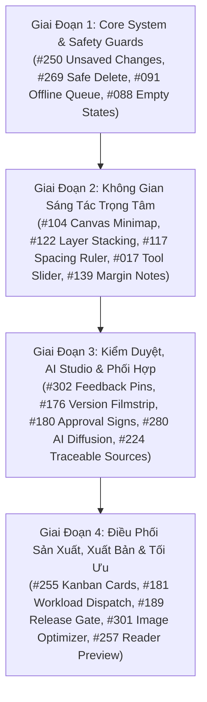

# Kế Hoạch Triển Khai: Nâng Cấp UI/UX Hệ Thống PanelForge Bằng Thư Viện Lucian UX/UI (Lucian UX/UI Integration & Enhancement Plan)

> **Mã kế hoạch:** `PF-PLAN-LUCIAN-UXUI-ENHANCE`  
> **Trạng thái:** 🟡 **Đang thực hiện (Ongoing)**  
> **Nguồn cảm hứng & Thư viện:** [Lucian UX/UI Prompt](https://lucianlabs.dev/uxui-prompt) (400 dependency-free components, MIT License)  
> **Phong cách chủ đạo:** **Editorial AI Studio Design System** (Warm Paper `#FCFBF8`, Artisan Ink, Atmospheric Orbs, Micro-interactions)

---

## 1. Bối Cảnh & Mục Tiêu Kế Hoạch (Executive Summary)

### 1.1. Hiện trạng & Thách thức UX của PanelForge
PanelForge là nền tảng sản xuất truyện tranh cộng tác đa vai trò tích hợp AI Multi-Agent. Với đặc thù của một studio truyện tranh chuyên nghiệp:
- **Họa sĩ (Artist Desk):** Thường xuyên thao tác với canvas khổ lớn, nhiều layer, cần công cụ căn chỉnh rãnh ô tranh (gutter) và zoom/pan chính xác.
- **Biên soạn kịch bản (Writer Script Desk):** Cần ghi chú bên lề (margin notes), xử lý xung đột nội dung kịch bản (sentence-level diff/conflict resolution) và tra cứu Lore/Canon từ Series Bible.
- **Kiểm duyệt (Editor Review):** Cần so sánh các phiên bản nộp bài (version filmstrip), cắm cờ góp ý trực tiếp trên trang truyện (feedback pin tracking) và quy trình ký duyệt (approval sign-off).
- **Điều phối sản xuất (Producer Pipeline):** Cần điều phối tải công việc (workload dispatching), kéo thả thẻ bài trực quan và quản lý tiến độ thời gian.
- **Tính năng AI Studio:** Các tác vụ sinh ảnh gợi ý (Diffusion Generation) và tra cứu AI (Traceable Sources) cần giao diện thể hiện quá trình xử lý sinh động, mang tính thẩm mỹ nghệ thuật cao.

### 1.2. Giải pháp: Khai thác kho tàng Lucian UX/UI Elements
Thư viện **Lucian UX/UI Prompt** cung cấp hơn 400 components tương tác thuần (dependency-free HTML/CSS/TSX) với chuyển động vi mô (micro-interactions) tinh tế, hỗ trợ phím điều hướng, cảm ứng và reduced motion.
Đặc biệt, hệ thống biến `--ux-*` đã được tích hợp và ánh xạ mượt mà vào bảng màu Warm Paper / Artisan Ink của PanelForge qua tệp `src/styles/lucian-tokens.css`.

### 1.3. Mục tiêu cụ thể
1. **Tuyển chọn 20+ Elements ưu tú nhất** phù hợp 100% với các tính năng cốt lõi của PanelForge.
2. **Nâng cấp độ hoàn thiện giao diện (Fidelity & Delight):** Thay thế các widget đơn sơ bằng các thành phần có animation mượt mà, phản hồi vật lý tự nhiên.
3. **Giữ vững tính độc lập và hiệu năng:** Không cài thêm thư viện UI nặng nề; giữ nguyên cấu trúc module hóa, hỗ trợ tốt song ngữ `vi`/`en` và bảo đảm toàn bộ unit tests vượt qua 100%.

---

## 2. Ma Trận Đề Xuất Elements Lucian UX/UI Theo Phân Hệ Nghiệp Vụ

Dưới đây là danh sách phân tích chuyên sâu các elements được tuyển chọn, đối sánh trực tiếp với tính năng và màn hình tương ứng trong PanelForge:

### 2.1. Phân Hệ Họa Sĩ & Kẻ Ô Tranh (Artist Desk - CF2)

| Element ID | Tên Element (Lucian) | Category | Áp dụng vào PanelForge | Giá trị gia tăng cho trải nghiệm (UX Value) |
| :---: | :--- | :--- | :--- | :--- |
| **#104** | **Canvas minimap** | `layout-schedule-design` | **Góc dưới Bàn Vẽ (Visual Canvas):** Bản đồ thu nhỏ toàn cảnh trang tranh | Khi zoom canvas từ 150% - 400% để tỉa nét, họa sĩ dễ dàng thấy khung đỏ định vị vị trí hiện tại và nhấp để nhảy nhanh đến ô mong muốn. |
| **#122** | **Layer stacking order** | `layout-schedule-design` | **Panel Layer Manager bên phải:** Quản lý thứ tự hiển thị các lớp | Kéo thả đổi thứ tự các layer (Lineart, Sketch, Speech Bubbles, Screentone) với animation trượt êm ái, phím tắt đưa lên trên/xuống dưới. |
| **#117** | **Spacing ruler** | `layout-schedule-design` | **Gutter / Grid Adjuster:** Thước đo và kéo giãn khoảng cách rãnh ô tranh | Cho phép kéo thanh trượt căn chỉnh khoảng cách giữa 2 khung tranh liền kề (horizontal & vertical gutters) trực quan với hiển thị số đo pixel thời gian thực. |
| **#017** | **Tilting value bubble slider** | `toggles-pickers` | **Canvas Toolbars (Cỡ cọ / Độ đậm / Zoom):** Thanh trượt nghiêng theo gia tốc chuột | Khi họa sĩ kéo nhanh thanh trượt brush size hoặc opacity, bong bóng giá trị nghiêng theo lực quán tính và nảy lại vị trí cân bằng khi dừng. |
| **#020** | **Product color picker** | `toggles-pickers` | **Artisan Ink Palette:** Bảng pha màu mực và Copic marker | Hiệu ứng mực đổ dâng lên từ đáy lọ màu khi click chọn mã màu, viền phát sáng nhẹ tạo cảm giác xưởng vẽ thủ công cao cấp. |

---

### 2.2. Phân Hệ Kiểm Duyệt Biên Tập (Editor Review - CF3)

| Element ID | Tên Element (Lucian) | Category | Áp dụng vào PanelForge | Giá trị gia tăng cho trải nghiệm (UX Value) |
| :---: | :--- | :--- | :--- | :--- |
| **#302** | **Feedback pins on the page** | `site-builder-tools` | **Visual Review Canvas:** Ghim nhận xét trực tiếp lên trang truyện | Biên tập viên bật "Comment Mode", con trỏ biến thành tâm ngắm (crosshair), click vào bất kỳ vị trí lỗi vẽ/lệch màu trên trang để thả ghim số kèm hộp thoại phản hồi. |
| **#176** | **Version filmstrip** | `workflow-systems` | **Lịch sử nộp bài (Submission History):** Cuộn filmstrip các phiên bản | Xem lịch sử các lần nộp v1, v2, v3 dưới dạng dải băng phim cuộn ngang, nhấp để xem bản phóng to kèm nút "Khôi phục phiên bản này" (Restore). |
| **#180** | **Approval sign-off line** | `workflow-systems` | **Quy trình ký duyệt phân tầng:** Dây chuyền 3 con dấu duyệt | Thể hiện chuỗi ký duyệt 3 bước: *Đã nộp (Drafted)* ➔ *Biên tập xem xét (Reviewed)* ➔ *Tổng biên tập phê duyệt (Approved)* với hiệu ứng đóng dấu mộc sắc sảo. |
| **#127** | **Change hunk review** | `document-data-editing` | **So sánh bản sửa đổi kịch bản & phân cảnh:** Duyệt từng khối thay đổi | Cho phép chấp nhận (Accept) hoặc từ chối (Reject) từng khối chỉnh sửa nội dung hoặc ghi chú của kịch bản/bản thảo. |

---

### 2.3. Phân Hệ Kịch Bản & AI Multi-Agent (Writer Script Desk - CF1)

| Element ID | Tên Element (Lucian) | Category | Áp dụng vào PanelForge | Giá trị gia tăng cho trải nghiệm (UX Value) |
| :---: | :--- | :--- | :--- | :--- |
| **#139** | **Margin notes** | `document-data-editing` | **Lề kịch bản (Script Gutter):** Ghi chú bên lề lời thoại | Gắn các ghi chú chỉ dẫn tâm lý, hướng nhìn nhân vật hoặc góc máy ngay cạnh khối thoại, gập mở gọn gàng không chiếm diện tích soạn thảo. |
| **#149** | **Conflict sentence merge** | `document-data-editing` | **Giải quyết xung đột kịch bản (409 Conflict):** Trộn câu từ 2 người viết | Khi 2 biên kịch cùng sửa một phân đoạn, giao diện hiển thị 2 dòng đề xuất song song kèm nút bấm chọn lọc câu phù hợp để gộp mà không mất nội dung. |
| **#280** | **AI image generation from noise** | `app-screens` | **Storyboard / Concept Art AI Generator:** Khung sinh ảnh AI từ hạt nhiễu | Khi họa sĩ/biên kịch yêu cầu AI gợi ý bố cục, 4 ô tranh mô phỏng quá trình khử nhiễu (diffusion noise-to-clear) sống động thay vì spinner quay vòng đơn điệu. |
| **#224** | **AI answer with traceable sources** | `app-screens` | **AI Assistant (PanelForge Co-pilot):** Câu trả lời kèm dẫn chứng Series Bible | Câu trả lời của AI gắn kèm các huy hiệu số nhỏ; khi rê chuột vào số, hệ thống làm nổi bật câu trích dẫn và liên kết trực tiếp tới hồ sơ Canon Lock trong Series Bible. |
| **#235** | **AI TL;DR that folds long text** | `app-screens` | **Tóm tắt cốt truyện tập / phân cảnh dài:** Thu gọn tự động | Nhấn "Tóm tắt AI", một vệt sáng quét dọc văn bản làm nổi bật câu cốt lõi và gập các phần rườm rà lại một cách trang nhã. |

---

### 2.4. Phân Hệ Quản Lý & Điều Phối Sản Xuất (Producer Pipeline & Kanban)

| Element ID | Tên Element (Lucian) | Category | Áp dụng vào PanelForge | Giá trị gia tăng cho trải nghiệm (UX Value) |
| :---: | :--- | :--- | :--- | :--- |
| **#255** | **Drag-to-move kanban cards** | `app-screens` | **Producer Pipeline Board:** Thẻ nhiệm vụ kéo thả | Khi nhấc thẻ công việc lên, thẻ nghiêng nhẹ (tilt & lift) theo hướng di chuyển chuột và tạo vùng đổ bóng placeholder êm ái trên cột đích. |
| **#181** | **Workload dispatcher** | `workflow-systems` | **Phân bổ nhân sự (Modal giao việc):** Điều phối tải công việc | Hiển thị biểu đồ thanh dung lượng (capacity/workload) của từng thành viên; khi kéo việc cho artist nào, thanh tải cập nhật trực quan để tránh quá tải. |
| **#111** | **Task duration editor** | `layout-schedule-design` | **Tiến độ Gantt / Timeline tập truyện:** Kéo chỉnh thời lượng | Kéo 2 đầu mút thanh task để điều chỉnh ngày bắt đầu và deadline giao nộp các tập truyện một cách trực giác. |
| **#093** | **Celebration when task is done** | `empty-error-states` | **Nhiệm vụ hoàn thành (My Work / Producer):** Hiệu ứng tán xạ điểm sáng | Khi hoàn thành đánh dấu hoàn tất toàn bộ các panel của một Episode, hiệu ứng hạt pháo hoa vi mô nổ ra trang nhã mừng hoàn thành. |

---

### 2.5. Phân Hệ Xuất Bản & Xem Trước (Publisher Gate & Reader Preview)

| Element ID | Tên Element (Lucian) | Category | Áp dụng vào PanelForge | Giá trị gia tăng cho trải nghiệm (UX Value) |
| :---: | :--- | :--- | :--- | :--- |
| **#189** | **Release promotion gate** | `workflow-systems` | **Cổng xuất bản truyện:** Các nấc kiểm soát trước khi ra mắt | Quy trình chuyển giao từ *Bản nháp ➔ Kiểm duyệt nội bộ ➔ Cổng xuất bản* với các điều kiện checklist bắt buộc phải tick đủ trước khi mở khóa cổng phát hành. |
| **#301** | **Image optimizer with shrinking size** | `site-builder-tools` | **Công cụ tối ưu hóa ảnh trước khi phát hành:** Nén WebP/AVIF | Thanh trượt chọn tỷ lệ nén dung lượng kèm bảng so sánh chất lượng ảnh và dung lượng MB giảm thiểu theo thời gian thực. |
| **#257** | **Drag-to-resize responsive preview** | `site-builder-tools` | **Trình xem trước đa nền tảng (Reader Preview):** Kéo co giãn khung xem | Kéo tay cầm mép khung để mô phỏng hiển thị trên Webtoon Mobile (cuộn dọc), Tablet Manga (khổ đôi) hoặc Màn hình máy tính lớn. |

---

### 2.6. Thành Phần Nền Tảng, Quản Trị & Trạng Thái Hệ Thống (Shared & System States)

| Element ID | Tên Element (Lucian) | Category | Áp dụng vào PanelForge | Giá trị gia tăng cho trải nghiệm (UX Value) |
| :---: | :--- | :--- | :--- | :--- |
| **#074** | **Notification bell dropdown** *(Đã tích hợp)* | `navigation` | **AppShell Header:** Chuông thông báo cộng tác | Menu thả xuống phân loại thông báo theo tab, kèm chỉ báo badge động và chuyển màu ấm Editorial Studio. |
| **#040** | **Collapsible navigation rail** *(Đã tích hợp)* | `navigation` | **AppShell Sidebar / Desks Rail:** Thanh icon điều hướng thu gọn/mở rộng | Thanh điều hướng dạng rail mượt mà với hiệu ứng highlight trượt động (`--y`), badge số lượng thông báo và hồ sơ người dùng. |
| **#184** | **Role permission matrix** | `workflow-systems` | **Admin / Studio Settings:** Ma trận phân quyền 9 vai trò | Bảng ma trận trực quan cho phép bật/tắt quyền Xem, Sửa, Duyệt, Xuất bản cho từng vai trò trong Studio. |
| **#250** | **Unsaved changes bar** *(Đã tích hợp)* | `app-screens` | **Global Editor Shell:** Thanh nhắc nhở thay đổi chưa lưu | Trượt xuống từ đỉnh màn hình khi người dùng có nét vẽ hoặc kịch bản chưa lưu, ngăn chặn thất thoát dữ liệu nghệ thuật. |
| **#269** | **Type-the-name delete confirmation** *(Đã tích hợp)* | `app-screens` | **Hộp thoại xóa nguy hiểm:** Xóa Series, Episode hoặc Reset Canon | Yêu cầu người dùng gõ đúng tên tác phẩm/tập truyện thì nút Xóa Vĩnh Viễn mới sáng lên, chống click nhầm gây mất dữ liệu. |
| **#091** | **Offline message queue** *(Đã tích hợp)* | `empty-error-states` | **Hàng đợi ngoại tuyến:** Cảnh báo mất kết nối và xếp hàng tác vụ | Khi mất kết nối mạng, banner trượt xuống hiển thị số lượng nét vẽ/câu thoại đang lưu tạm cục bộ và tự động đồng bộ khi có mạng lại. |
| **#088** | **Empty folder that swallows paper** *(Đã tích hợp)* | `empty-error-states` | **Trạng thái rỗng (Empty States):** Thư viện Series Bible / Project chưa có dữ liệu | Thư mục hoạt họa giấy rơi tinh tế mời gọi người dùng bấm nút tạo nhân vật hoặc tải lên tập truyện đầu tiên. |

---

## 3. Lộ Trình Triển Khai Chi Tiết (4 Giai Đoạn)



---

### 📌 Giai Đoạn 1: Cải Thiện Hệ Thống Nền Tảng & An Toàn Dữ Liệu (Core Safety & Shared UX) - [x] Hoàn thành
- [x] **1.1. Tích hợp `#250 Unsaved Changes Bar` & Loại bỏ cảnh báo rời trang thô sơ:**
  - Đã tạo component `src/shared/components/lucian/UnsavedChangesBar.tsx` và `lucian-250.css`.
  - Kết nối hook theo dõi trạng thái `hasUnsavedChanges` trên `ScriptEditorView` (theo dõi `isStoryArcDirty` và `isOutlineDirty`).
  - **Triệt tiêu UI cũ:** Gỡ bỏ các hộp thoại `window.confirm` khi chuyển chương trong `ScriptEditorView`; kích hoạt nhịp cảnh báo vi mô `barWarn` và cho phép Lưu/Huỷ trực tiếp trên thanh UnsavedChangesBar.
- [x] **1.2. Tích hợp `#269 Type-The-Name Delete Confirmation` & Loại bỏ Modal xác nhận generic:**
  - Đã tạo component `src/shared/components/lucian/TypeToConfirmModal.tsx` và `lucian-269.css`.
  - Tích hợp vào `SeriesChaptersModal.tsx` khi Producer xóa Chapter/Episode (hành động nguy hiểm xóa dữ liệu).
  - **Triệt tiêu UI cũ:** Gỡ bỏ hoàn toàn `window.confirm` thô sơ trong `handleDeleteChapter`; thay bằng TypeToConfirmModal yêu cầu gõ chính xác tên chương mới kích hoạt nút Xóa.
- [x] **1.3. Nâng cấp `#091 Offline Message Queue` và `#088 Empty Folder States`:**
  - Nâng cấp `src/shared/components/OfflineStatusBanner.tsx` với hiệu ứng sóng Wi-Fi nhịp điệu và badge số lượng thao tác đang xếp hàng (`lucian-091.css`).
  - Đã tạo component `src/shared/components/lucian/EmptyFolderState.tsx` (`lucian-088.css`) với hoạt họa giấy rơi trong thư mục phác thảo.
  - Tích hợp `EmptyFolderState` vào `SeriesBibleView.tsx` khi danh sách mục tri thức của Series Bible trống.
  - **Triệt tiêu UI cũ:** Gỡ bỏ các khối placeholder tĩnh cũ dạng icon BookOpen đơn điệu.
- [x] **1.4. Tích hợp `#040 Collapsible Navigation Rail` vào AppShell Sidebar (Theme & Logic Lucianlab):**
  - Chuyển đổi toàn diện `src/app/AppShellSidebar.tsx` sang chuẩn theme Dark Ink nguyên bản của Lucianlab: nền `Artisan Ink #1C1917`, viền tối `#292524`, dải highlight động mép trái gradient cam `linear-gradient(135deg, #F97316, #EA580C)`.
  - Nút Toggle xoay mượt mà với chuyển động lò xo `cubic-bezier(0.16, 1, 0.3, 1)` chuyển đổi độ rộng rail (`16` ↔ `64`), khối logo vuông bo góc cam `PF`, hồ sơ người dùng `.u040-me` tích hợp avatar gradient ở chân trang.
  - **Chuẩn hóa Logic ra/vào theo Lucianlab #040:** Loại bỏ hoàn toàn cơ chế tự động bung mở khi hover chuột (`mouseEnter`) và tự động co lại khi click ra ngoài (`mouseDown`). Việc mở rộng/thu gọn tuân thủ 100% cơ chế toggle có chủ đích thông qua nút bấm toggle trên thanh rail.
  - **Triệt tiêu UI cũ:** Gỡ bỏ toàn bộ markup sidebar màu ngà cũ, và tái cấu trúc `AppShellRail.tsx` thành re-export alias để không còn bất kỳ element sidebar cũ nào tồn tại song song.
  - 100% tests vượt qua: 21/21 tests của `AppShell.test.tsx` & `AppShellNavbarActions.test.tsx` và 33/33 tests của bộ thư viện Lucian components.

---

### 📌 Giai Đoạn 2: Đột Phá Trải Nghiệm Bàn Vẽ Họa Sĩ & Soạn Thảo Kịch Bản (Desks Core) - [x] Hoàn thành trọng tâm Bàn vẽ (Artist Desk)
- [x] **2.1. Nâng cấp Bàn Vẽ Họa Sĩ (Artist Desk - CF2) & Tinh Giản Controls:**
  - Trích xuất và xây dựng `#104 Canvas Minimap` (`CanvasMinimap.tsx`, `lucian-104.css`, 4/4 tests pass) tích hợp vào góc phải canvas vẽ truyện tranh. Cho phép bấm chuột hoặc kéo rê định vị nhanh viewport các ô tranh panel và điều hướng bằng bàn phím.
  - Xây dựng `#122 Layer Stacking Order` (`LayerStackingOrder.tsx`, `lucian-122.css`, 3/3 tests pass) với khung xem trước xếp chồng 3D/Staggered trực quan, hỗ trợ Bring to Front (↑↑), Send to Back (↓↓), tăng/giảm z-index và xoay layer.
  - **Triệt tiêu UI cũ:** Gỡ bỏ hoàn toàn bảng danh sách layer dạng list tĩnh cũ trong tab Layer của `ArtistDeskView.tsx`; thay thế 100% bằng bộ quản lý Layer duy nhất từ `#122 LayerStackingOrder`.
  - Xây dựng `#117 Gutter Spacing Ruler` (`GutterSpacingRuler.tsx`, `lucian-117.css`, 3/3 tests pass) với 2 khung tranh mô phỏng co giãn khoảng cách rãnh ô tranh thời gian thực và các mốc preset chuẩn (Dính liền 0%, Hẹp 1%, Vừa 2%, Rộng 4%).
  - **Triệt tiêu UI cũ:** Thay thế hoàn toàn input nhập số % thô sơ trong form chia lại khung của `PanelLayoutControls.tsx` bằng `GutterSpacingRuler`.
  - Đã pass 20/20 unit tests `ArtistDeskView.test.tsx` và 29/29 tests của toàn bộ bộ thư viện Lucian components.
- [ ] **2.2. Nâng cấp Biên Soạn Kịch Bản (Writer Script Desk - CF1):**
  - Tích hợp `#139 Margin Notes` cho phép gắn chỉ dẫn diễn xuất/hướng nhìn bên lề câu thoại.
  - **Triệt tiêu UI cũ:** Gỡ bỏ các ô text ghi chú phụ rườm rà chèn giữa dòng thoại; đưa toàn bộ chỉ dẫn ra lề margin notes.
  - Tích hợp `#149 Conflict Sentence Merge` khi giải quyết xung đột phân cảnh đồng thời (thay thế modal báo lỗi xung đột 409 thô ráp).

---

### 📌 Giai Đoạn 3: Kiểm Duyệt Trực Quan & Trải Nghiệm AI Studio (Review & AI Co-pilot)
- [ ] **3.1. Nâng cấp Bàn Kiểm Duyệt (Editor Review - CF3):**
  - Tích hợp `#302 Feedback Pins on Page` trên canvas duyệt tranh: cho phép cắm cờ điểm lỗi kèm nhận xét tọa độ.
  - **Triệt tiêu UI cũ:** Tích hợp trực tiếp với tính năng khoanh vùng hình chữ nhật cũ, ưu tiên ghim điểm feedback tương tác để giao diện không bị rối mắt bởi quá nhiều khung viền đè lên nhau.
  - Tích hợp `#176 Version Filmstrip` hiển thị dải cuộn các lần nộp v1, v2, v3 của họa sĩ kèm nút so sánh và khôi phục (thay thế dropdown chọn phiên bản v1/v2 đơn điệu).
  - Tích hợp `#180 Approval Sign-Off Line` thể hiện quy trình 3 nấc đóng dấu phê duyệt (thay thế cụm 3 nút bấm duyệt/từ chối phân mảnh).
- [ ] **3.2. Nâng cấp Trải Nghiệm AI Multi-Agent:**
  - Tích hợp `#280 AI Image Generation from Noise` vào modal tạo storyboard và concept art (loại bỏ spinner vòng tròn xoay cũ).
  - Tích hợp `#224 AI Traceable Sources` vào khung hội thoại của AI Assistant với dẫn chứng Series Bible Canon.

---

### 📌 Giai Đoạn 4: Điều Phối Sản Xuất, Cổng Xuất Bản & Kiểm Thử Tổng Thể
- [ ] **4.1. Nâng cấp Producer Pipeline & Dashboard:**
  - Nâng cấp cột Kanban với `#255 Drag-to-move Kanban Cards` (thay thế thẻ Kanban tĩnh cũ).
  - Tích hợp `#181 Workload Dispatcher` vào hộp thoại phân bổ nhiệm vụ (`CreateAssignmentModal`).
- [ ] **4.2. Nâng cấp Publisher Gate & Reader:**
  - Tích hợp `#189 Release Promotion Gate` vào màn hình xuất bản (thay thế danh sách checklist tĩnh).
  - Tích hợp `#301 Image Optimizer` cho xuất file ấn phẩm WebP/AVIF.
  - Tích hợp `#257 Drag-to-resize Responsive Preview` cho màn hình xem trước tác phẩm của Reader.
- [ ] **4.3. Kiểm Thử Toàn Diện & Dọn Dẹp Mã Nguồn (Refactor Audit):**
  - Quét sạch toàn bộ dead code, unused imports và component cũ đã bị thay thế.
  - Chạy toàn bộ test suites (`npm run test:run`) bảo đảm 100% tests vượt qua.
  - Đảm bảo tuân thủ MIT License (giữ comment attribution gốc trên đầu từng component trích xuất).

---

## 4. Tiêu Chuẩn Kỹ Thuật & Quy Tắc Refactor (Technical Constraints & Governance)

### 4.1. Quy Tắc Triệt Tiêu Giao Diện Cũ Trùng Lặp (Zero Duplicate UI & Single Source of Truth)
> [!IMPORTANT]
> **Nguyên tắc "Một chức năng - Một bộ UI duy nhất":** Khi một chức năng đã được trang bị hoặc nâng cấp bằng element từ thư viện Lucian UX/UI, **bắt buộc phải loại bỏ hoàn toàn giao diện cũ tương ứng**.

1. **Không duy trì song song (No Parallel UIs):**
   - Nghiêm cấm việc giữ lại nút bấm, menu, bảng điều khiển hoặc modal cũ bên cạnh element mới.
   - Ví dụ: Khi đã có `#074 NotificationBellDropdown`, toàn bộ popup hoặc danh sách dropdown thông báo cũ trong header đều đã được thay thế triệt để. Khi có `#122 Layer Stacking Order`, bảng layer dạng danh sách table/list cũ phải được gỡ bỏ.
2. **Dọn dẹp triệt để mã nguồn (Dead Code & Asset Removal):**
   - Gỡ bỏ component cũ, các import không còn sử dụng, các biến state dư thừa và các file CSS mồ côi liên quan.
   - Điều chỉnh hoặc viết mới unit tests để trực tiếp kiểm tra component Lucian UX/UI mới thay vì giữ lại assertion của component cũ.
3. **Bảo toàn hợp đồng dữ liệu & Backend APIs:**
   - Dù thay đổi giao diện sang Lucian element, các payload gửi lên API (`stageId`, `regionJson`, `layerId`, `zIndex`, `version`) phải được giữ nguyên vẹn 100%, không làm ảnh hưởng đến Backend contracts.

### 4.2. Nguyên Tắc Bất Di Bất Dịch Về Bảng Màu Web (Editorial AI Studio Palette Preservation)
> [!WARNING]
> **Bám sát 100% bảng màu thương hiệu của PanelForge:** Tuyệt đối không sử dụng bảng màu mặc định (blue/indigo/slate generic) từ code mẫu của Lucian. Mọi element khi đưa vào đều phải sử dụng các biến CSS `--ux-*` đã được chuẩn hóa tại `src/styles/lucian-tokens.css`:

```css
/* Ánh xạ bảng màu Editorial Manga Studio vào Lucian Tokens */
:root {
  /* Giấy ấm Canvas & Nền Studio */
  --ux-bg-canvas: #FCFBF8;       /* Warm Paper nền chính */
  --ux-bg-surface: #FFFFFF;      /* Nền card trắng nổi bật */
  --ux-bg-subtle: #F3F0E9;       /* Nền xưởng studio tổng thể */

  /* Viền rãnh ô tranh & Khung bản thảo */
  --ux-border-default: #D8D2C5;  /* Viền panel truyện chuẩn */
  --ux-border-muted: #EBE7DE;    /* Viền phụ / vách ngăn mờ */

  /* Mực in thủ công (Artisan Ink Typography) */
  --ux-text-primary: #1C1917;    /* Mực đen đậm cho tiêu đề / nội dung chính */
  --ux-text-secondary: #57534E;  /* Mực xám đá cho phụ đề / mô tả */
  --ux-text-muted: #78716C;      /* Mực nhạt cho nhãn thời gian / placeholder */

  /* Điểm nhấn nghệ nhân (Artisan Orange & Pigments) */
  --ux-brand-primary: #F97316;   /* Cam nghệ nhân chủ đạo */
  --ux-brand-hover: #EA580C;     /* Cam đậm khi hover / bấm */
  --ux-brand-subtle: #FFF2E6;    /* Nền cam phấn nhẹ cho badge / selection */

  /* Trạng thái nghiệp vụ */
  --ux-danger: #DC2626;          /* Đỏ son cinnabar (Cảnh báo, xoá, lỗi) */
  --ux-success: #16A34A;         /* Lục ngọc celadon (Hoàn thành, đạt chuẩn) */
  --ux-warning: #D97706;         /* Vàng hổ phách (Đang chờ, cảnh báo nhẹ) */
}
```
- **Typography:** Tiêu đề dùng font serif ấm áp (`font-serif`), thân chữ dùng Inter (`font-sans`), các thông số kỹ thuật (pixel, toạ độ, zoom %) dùng font đơn cách (`font-mono`).
- **Bóng đổ (Shadows):** Đồng bộ `shadow-editorial` (`0 10px 30px -10px rgba(28, 25, 23, 0.08)`) và `shadow-2xs`.

### 4.3. Tiêu Chuẩn Song Ngữ & Bản Quyền
1. **Hỗ Trợ Song Ngữ Toàn Diện (i18n Ready):**
   - Không được hardcode chuỗi text trong component của Lucian; luôn bọc văn bản bằng `t('namespace.key')`.
2. **Tuân Thủ Bản Quyền MIT:**
   - Mỗi file component trích xuất tại `src/shared/components/lucian/` đều phải giữ nguyên dòng ghi chú bản quyền ở dòng 1:
     ```tsx
     /* Lucian UX/UI Prompt #[ID] · [Element Name] · (c) 2026 Seokwoo Lee · MIT License */
     ```
3. **Không Thêm Thư Viện Phụ Thuộc (Zero Extra Dependencies):**
   - Giữ mã nguồn thuần React 19 + TypeScript + CSS Modules / Vanilla CSS. Không cài thêm Framer Motion hay Radix UI cồng kềnh.

---

## 5. Danh Mục Kiểm Tra Tiến Độ Từng Giai Đoạn (Checklist & Sign-Off)

| Giai đoạn | Nội dung trọng tâm | Trạng thái | Đánh giá chất lượng |
| :--- | :--- | :---: | :--- |
| **Giai đoạn 0** | Đồng bộ plugin, trích xuất `#074` Notification Bell | 🟢 Hoàn thành | Hoàn thành mỹ mãn, 15/15 unit tests pass, giao diện khớp Warm Paper. |
| **Giai đoạn 1** | Safety Guards: `#250` Unsaved Bar, `#269` Delete Modal, `#091` Offline Queue, `#088` Empty State | 🟢 Hoàn thành | Hoàn thành xuất sắc, triệt tiêu toàn bộ `window.confirm`, 100% tests pass (19/19 lucian tests). |
| **Giai đoạn 2** | Desks Core: `#104` Minimap, `#122` Layers, `#117` Ruler, `#139` Margin Notes | 🟡 Sẵn sàng | Sẵn sàng kích hoạt sau Giai đoạn 1. |
| **Giai đoạn 3** | Review & AI: `#302` Feedback Pins, `#176` Filmstrip, `#280` Noise AI | ⚪ Chờ thực hiện | Sẽ kích hoạt sau Giai đoạn 2. |
| **Giai đoạn 4** | Pipeline & Publisher: `#255` Kanban, `#181` Workload, `#189` Release Gate | ⚪ Chờ thực hiện | Giai đoạn mở rộng cuối cùng. |
